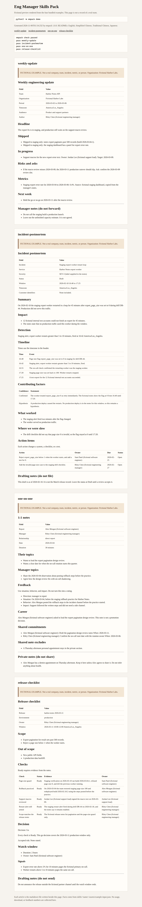

[English](README.md) · [简体中文](README.zh-Hans.md) · [繁體中文](README.zh-Hant.md) · [日本語](README.ja.md)

# eng-manager-skills-pack

そのまま追加できる執筆スキルです。エンジニアリングマネージャーが、週次報告、インシデントのポストモーテム、1:1、リリースのチェックリストを、毎回白紙から書き直さずに済みます。

**想定する人。** 別拠点のプロダクト、サポート、パートナーに英語で文書を書くエンジニアリングマネージャーとテックリード。タイムゾーンをまたぐことが多い人です。

**困っていること。** 同じ進捗報告、障害の振り返り、1:1、リリース確認を、毎週数時間かけて白紙から書き直している。

## インストールして実行する

Python 3.11 以降。コマンドは標準ライブラリだけを使います。

<!-- quickstart:start -->
1. このリポジトリをクローンして入る: `git clone https://github.com/xuqijx/eng-manager-skills-pack.git && cd eng-manager-skills-pack`
2. パックを検証し、架空のプレビューを書き出す: `python3 -m empack demo`
3. スキルをインストールして文書を頼む: `python3 -m empack install --dest ~/.cursor/skills`（Claude のユーザースキルは `~/.claude/skills`）。その後、週次報告、ポストモーテム、1:1、またはリリースチェックリストを依頼する。
<!-- quickstart:end -->

手順 2 は `dist/demo/index.html` と 4 本の Markdown 下書きを書き、ネットワークには接続しません。HTML を手元で開くと、架空の Harbor Labs の例を読めます。

手順 3 は 4 つのスキルフォルダをコピーします。Cursor はプロジェクト内の `.cursor/skills/` と `.agents/skills/` も読みます。Claude のプロジェクトスキルは `.claude/skills/` です。一つのプロジェクトだけに置くときは、そのディレクトリを `--dest` に渡します。再実行で置き換わるのは、この 4 つのフォルダ名だけです。

スキルは貼り付けたメモから下書きします。パスワード、アクセスキー、顧客の私的データは貼らないでください。

## スキル

| スキル | 書き出す文書 |
| --- | --- |
| `weekly-update` | チーム外の相手向け、1 ページのエンジニアリング週次報告 |
| `incident-postmortem` | 非難のないポストモーテム。時系列、要因、アクションを含む |
| `one-on-one` | 1:1 の議題。共有メモとマネージャーの非公開メモを分ける |
| `release-checklist` | リリースの Go / No-go。根拠、切り戻し、監視時間を含む |

各スキルはフォルダです。中身は `SKILL.md`、`assets/template.md`、`assets/example-input.json` です。スキル用ディレクトリに置くと、Cursor と Claude が `SKILL.md` を読みます。テンプレートが文書の形で、JSON は架空の予行演習です。実在のチームではありません。

## 架空の例

付属の例はすべて `FICTIONAL EXAMPLE` で始まり、舞台は Fictional Harbor Labs です。登場人物は fictional と書いてあります。プレビューコマンドは、そのファイルをテンプレートに埋めるだけです。実在の会社を記述せず、このリポジトリは利用数やダウンロード数も公表しません。

## コマンド

リポジトリのルートで実行します。

```
python3 -m empack check
python3 -m empack demo
python3 -m empack install --dest ~/.cursor/skills
python3 -m unittest discover -s tests -t . -v
```

パックが揃っているとき、`check` は `pass weekly-update`、`pass incident-postmortem`、`pass one-on-one`、`pass release-checklist` と出します。GitHub Actions でも同じ確認を実行します。

## 手元の実行を撮った画面



この画像は、手元で一度実行した `python3 -m empack demo` が書いた `dist/demo/index.html` を Chrome で開いて撮ったものです。ページ上の時刻は `2026-11-06T01:54:25Z` です。`dist/` は git に入れません。プレビューを作り直すときは、同じコマンドをもう一度実行します。

## ライセンス

MIT。`LICENSE` を参照。

このパックは MIT ライセンスのまま無料です。ノート用テンプレートの任意の別冊を、後から公開することがあります。このリポジトリを使うのに購入は要りません。

## しないこと

スキルが書くのは Markdown の下書きだけです。チケット作成、呼び出し、メール送信、実在チームの測定はしません。`Go` は、メモに根拠があるときだけです。根拠がなければ `Not ready` または `Not provided` のままです。
