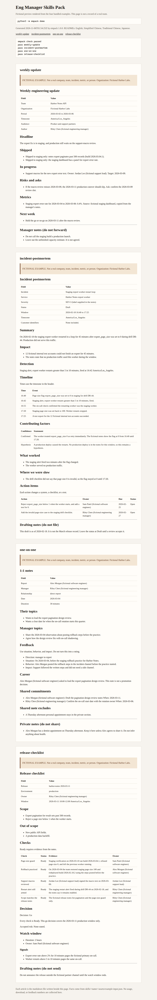

[English](README.md) · [简体中文](README.zh-Hans.md) · [繁體中文](README.zh-Hant.md) · [日本語](README.ja.md)

# eng-manager-skills-pack

Drop-in writing skills so engineering managers stop rebuilding the same weekly update, postmortem, 1:1, and release checklist.

**Audience.** Engineering managers and tech leads who write in English for product, support, and other partners outside the immediate team, often across timezones.

**Pain.** Several hours a week go into rewriting the same status notes, incident reviews, 1:1s, and launch checklists from a blank page.

## Install and run

Python 3.11 or newer. The commands use the standard library only.

<!-- quickstart:start -->
1. Clone this repository and enter it: `git clone https://github.com/xuqijx/eng-manager-skills-pack.git && cd eng-manager-skills-pack`
2. Validate the pack and write the fictional preview: `python3 -m empack demo`
3. Install the skills and ask for a document: `python3 -m empack install --dest ~/.cursor/skills` (Claude user skills: `~/.claude/skills`), then ask for a weekly update, incident postmortem, 1:1, or release checklist.
<!-- quickstart:end -->

Step 2 writes `dist/demo/index.html` and the four markdown drafts. It does not use the network. Open the HTML file locally to read the fictional Harbor Labs examples.

Step 3 copies the four skill folders. Cursor also reads project skills from `.cursor/skills/` or `.agents/skills/`. Claude project skills live in `.claude/skills/`. Pass that directory as `--dest` when you want the skills in one project instead of your user directory. Re-running install replaces only these four folder names.

The skills draft from notes you paste. Do not paste passwords, access keys, or private customer data.

## Skills

| Skill | Draft it produces |
| --- | --- |
| `weekly-update` | One-page weekly engineering update for partners outside the team |
| `incident-postmortem` | Blameless incident review with timeline, factors, and action items |
| `one-on-one` | 1:1 agenda with shared notes kept apart from private manager notes |
| `release-checklist` | Release go / no-go checklist with evidence, rollback, and a watch window |

Each skill is a folder: `SKILL.md` plus `assets/template.md` and `assets/example-input.json`. Cursor and Claude load `SKILL.md` when the folder sits in a skills directory. The template is the document shape. The JSON file is a fictional dry run, not a real team.

## Fictional examples

Every bundled example starts with `FICTIONAL EXAMPLE` and is set at Fictional Harbor Labs. People in those files are labeled fictional. The preview command only rearranges those files into the templates. It does not describe a real company, and this repository does not publish usage or download counts.

## Commands

Run these from the repository root:

```
python3 -m empack check
python3 -m empack demo
python3 -m empack install --dest ~/.cursor/skills
python3 -m unittest discover -s tests -t . -v
```

`check` reports `pass weekly-update`, `pass incident-postmortem`, `pass one-on-one`, and `pass release-checklist` when the pack is intact. The same checks run in GitHub Actions.

## Captured preview



This image is a Chrome capture of `dist/demo/index.html` from one local `python3 -m empack demo` run. The page clock reads `2026-11-06T01:54:25Z`. The `dist/` directory is gitignored. Run the command again to regenerate the preview.

## License

MIT. See `LICENSE`.

This pack stays free under the MIT license. A separate, optional companion kit of note templates may be published later. Nothing in this repository requires a purchase.

## What this does not do

The skills draft markdown. They do not file tickets, page anyone, send mail, or measure a real team. A `Go` decision still requires the evidence in your notes. Missing evidence stays `Not ready` or `Not provided`.
