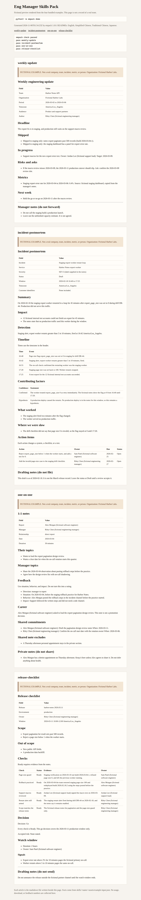

[English](README.md) · [简体中文](README.zh-Hans.md) · [繁體中文](README.zh-Hant.md) · [日本語](README.ja.md)

# eng-manager-skills-pack

一套可直接装上的写作技能，让工程经理不用每次从空白页重写周报、事故复盘、一对一和发布检查清单。

**受众。** 面向跨时区协作、并用英语给产品、支持和团队之外的伙伴写这些文档的工程经理与技术负责人。

**痛点。** 每周要花好几个小时，把同样的状态说明、事故复盘、一对一和发布检查从空白页再写一遍。

## 安装并运行

需要 Python 3.11 或更新版本。命令只用标准库。

<!-- quickstart:start -->
1. 克隆本仓库并进入目录：`git clone https://github.com/xuqijx/eng-manager-skills-pack.git && cd eng-manager-skills-pack`
2. 校验技能包并写出虚构预览：`python3 -m empack demo`
3. 安装技能并请代理写文档：`python3 -m empack install --dest ~/.cursor/skills`（Claude 的用户技能目录是 `~/.claude/skills`），然后请它写周报、事故复盘、一对一或发布检查清单。
<!-- quickstart:end -->

第 2 步会写出 `dist/demo/index.html` 和四份 Markdown 草稿，不会访问网络。在本机打开这个 HTML，即可阅读虚构的 Harbor Labs 示例。

第 3 步复制四个技能文件夹。Cursor 也会读取项目里的 `.cursor/skills/` 或 `.agents/skills/`。Claude 的项目技能放在 `.claude/skills/`。如果只想装进某一个项目，把该目录传给 `--dest`。再次安装只会覆盖这四个同名文件夹。

技能根据你贴上的笔记起草。不要粘贴密码、访问密钥或客户隐私。

## 技能

| 技能 | 写出的文档 |
| --- | --- |
| `weekly-update` | 给团队外伙伴的一页工程周报 |
| `incident-postmortem` | 不含指责的事故复盘，含时间线、因素和行动项 |
| `one-on-one` | 一对一议程，共享笔记与管理者私人笔记分开 |
| `release-checklist` | 发布走 / 不走检查清单，含证据、回滚和观察窗 |

每个技能是一个文件夹：`SKILL.md`、`assets/template.md` 和 `assets/example-input.json`。文件夹放进技能目录后，Cursor 和 Claude 会加载 `SKILL.md`。模板是文档结构。JSON 是虚构演练，不是真实团队。

## 虚构示例

所有附带示例都以 `FICTIONAL EXAMPLE` 开头，场景都在 Fictional Harbor Labs。文件里的人物都标明了 fictional。预览命令只是把这些文件填进模板，不描述真实公司。本仓库也不公布使用量或下载量。

## 命令

在仓库根目录运行：

```
python3 -m empack check
python3 -m empack demo
python3 -m empack install --dest ~/.cursor/skills
python3 -m unittest discover -s tests -t . -v
```

技能包完整时，`check` 会报告 `pass weekly-update`、`pass incident-postmortem`、`pass one-on-one` 和 `pass release-checklist`。GitHub Actions 会跑同样的检查。

## 一次本地运行的截图



这张图是同一次本地 `python3 -m empack demo` 写出的 `dist/demo/index.html`，用 Chrome 打开后截下的。页面上的时间是 `2026-11-06T01:54:25Z`。`dist/` 不进入版本库。要重新生成预览，再跑一次该命令。

## 许可证

MIT。见 `LICENSE`。

本技能包以 MIT 许可证保持免费。以后可能会另行提供一套可选的笔记模板。使用本仓库不需要付费。

## 它不做什么

这些技能只起草 Markdown。它们不建工单、不呼叫任何人、不发邮件，也不衡量真实团队。`Go` 仍然取决于你的笔记里有没有证据。没有证据就保持 `Not ready` 或 `Not provided`。
