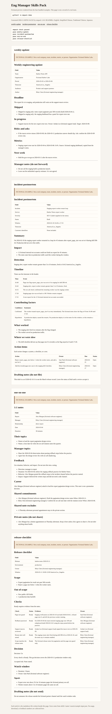

[English](README.md) · [简体中文](README.zh-Hans.md) · [繁體中文](README.zh-Hant.md) · [日本語](README.ja.md)

# eng-manager-skills-pack

一套可直接裝上的寫作技能，讓工程經理不用每次從空白頁重寫週報、事故覆盤、一對一和發布檢查清單。

**受眾。** 面向跨時區協作、並用英語給產品、支援和團隊之外的夥伴寫這些文件的工程經理與技術負責人。

**痛點。** 每週要花好幾個小時，把同樣的進度說明、事故覆盤、一對一和發布檢查從空白頁再寫一次。

## 安裝並執行

需要 Python 3.11 或更新版本。命令只用標準函式庫。

<!-- quickstart:start -->
1. 克隆本儲存庫並進入目錄：`git clone https://github.com/xuqijx/eng-manager-skills-pack.git && cd eng-manager-skills-pack`
2. 驗證技能包並寫出虛構預覽：`python3 -m empack demo`
3. 安裝技能並請代理寫文件：`python3 -m empack install --dest ~/.cursor/skills`（Claude 的使用者技能目錄是 `~/.claude/skills`），然後請它寫週報、事故覆盤、一對一或發布檢查清單。
<!-- quickstart:end -->

第 2 步會寫出 `dist/demo/index.html` 和四份 Markdown 草稿，不會存取網路。在本機打開這個 HTML，即可閱讀虛構的 Harbor Labs 範例。

第 3 步複製四個技能資料夾。Cursor 也會讀取專案裡的 `.cursor/skills/` 或 `.agents/skills/`。Claude 的專案技能放在 `.claude/skills/`。如果只想裝進某一個專案，把該目錄傳給 `--dest`。再次安裝只會覆蓋這四個同名資料夾。

技能根據你貼上的筆記起草。不要貼上密碼、存取金鑰或客戶隱私。

## 技能

| 技能 | 寫出的文件 |
| --- | --- |
| `weekly-update` | 給團隊外夥伴的一頁工程週報 |
| `incident-postmortem` | 不含指責的事故覆盤，含時間線、因素和行動項 |
| `one-on-one` | 一對一議程，共享筆記與管理者私人筆記分開 |
| `release-checklist` | 發布走 / 不走檢查清單，含證據、回滾和觀察窗 |

每個技能是一個資料夾：`SKILL.md`、`assets/template.md` 和 `assets/example-input.json`。資料夾放進技能目錄後，Cursor 和 Claude 會載入 `SKILL.md`。模板是文件結構。JSON 是虛構演練，不是真實團隊。

## 虛構範例

所有附帶範例都以 `FICTIONAL EXAMPLE` 開頭，場景都在 Fictional Harbor Labs。檔案裡的人物都標明了 fictional。預覽命令只是把這些檔案填進模板，不描述真實公司。本儲存庫也不公布使用量或下載量。

## 命令

在儲存庫根目錄執行：

```
python3 -m empack check
python3 -m empack demo
python3 -m empack install --dest ~/.cursor/skills
python3 -m unittest discover -s tests -t . -v
```

技能包完整時，`check` 會報告 `pass weekly-update`、`pass incident-postmortem`、`pass one-on-one` 和 `pass release-checklist`。GitHub Actions 會跑同樣的檢查。

## 一次本地執行的截圖



這張圖是同一次本地 `python3 -m empack demo` 寫出的 `dist/demo/index.html`，用 Chrome 打開後截下的。頁面上的時間是 `2026-11-06T01:54:25Z`。`dist/` 不進入版本庫。要重新產生預覽，再跑一次該命令。

## 授權條款

MIT。見 `LICENSE`。

本技能包以 MIT 授權條款維持免費。以後可能會另行提供一套可選的筆記模板。使用本儲存庫不需要付費。

## 它不做什麼

這些技能只起草 Markdown。它們不開工單、不呼叫任何人、不寄信，也不衡量真實團隊。`Go` 仍然取決於你的筆記裡有沒有證據。沒有證據就保持 `Not ready` 或 `Not provided`。
